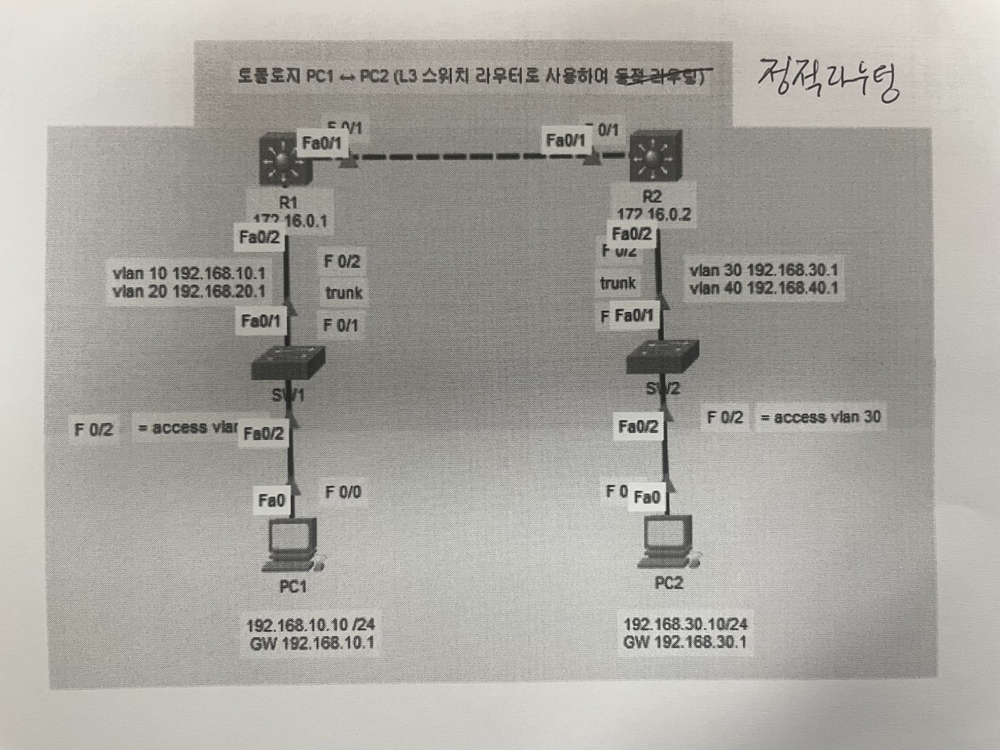
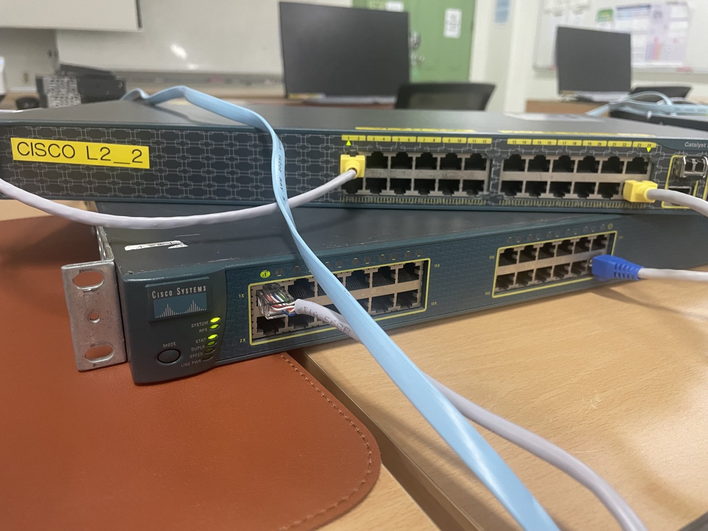

# L3 스위치로 정적 라우팅 해보기

2026-10-30 수업 실습. 실제 시스코 스위치로 했음.

## 뭘 했냐면
PC1(192.168.10.10)이랑 PC2(192.168.30.10)는 네트워크가 달라서 그냥은 통신이 안 됨.
L3 스위치 2대를 라우터처럼 쓰고, 정적 라우팅으로 길을 직접 알려줘서 ping이 되게 만드는 실습.

## 구성도


- R1 ↔ R2 연결: 172.16.0.1 ↔ 172.16.0.2
- PC1: VLAN 10, 게이트웨이 192.168.10.1
- PC2: VLAN 30, 게이트웨이 192.168.30.1

## 실습 장비


## 설정한 것 (R1)
```
ip routing

interface fa0/1
 no switchport
 ip address 172.16.0.1 255.255.255.0

interface fa0/2
 switchport trunk encapsulation dot1q
 switchport mode trunk

interface vlan 10
 ip address 192.168.10.1 255.255.255.0

ip route 192.168.30.0 255.255.255.0 172.16.0.2
```
R2도 똑같이 하고 방향만 반대로 (192.168.10.0 → 172.16.0.1)

## 결과
PC1에서 PC2로 ping 성공

## 느낀 점
-L2 / L3 스위치를 혼동해서 전송을 착각함. 패킷 트레이서에서 하던
enable, configure terminal을 실제 장비를 갖고서 하면서 ping 까지 성공시키니까 작업이 더 실감이 났다. 중간에 라우팅 테이블을 만들지 않아서
전송이 되지 않았던 것도.. 이론적/개념적 라우팅 테이블이 아니라 체감할 수 있는 라우팅 테이블의 역할을 실감했다.
